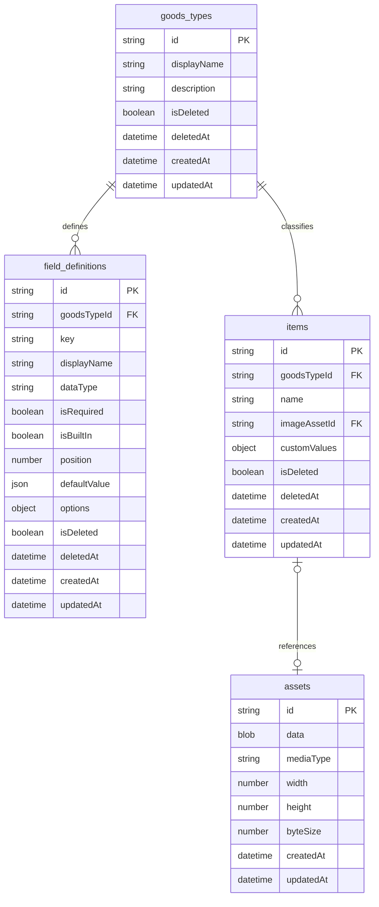

# Domain Model

This document defines the records and invariants used by the current app.
User actions are covered in [Workflows](workflows.md). Physical storage is
covered in [Persistence](persistence.md).

## Core Rules

- One physical schema stores every goods type.
- Field definitions are records, not database columns.
- IDs are stable and do not come from editable labels.
- Built-in item fields have fixed meaning.
- Soft-deleted items keep their values and image until purge.
- Domain records do not depend on IndexedDB or the UI.

## Naming

| Kind | Rule |
| --- | --- |
| JavaScript properties | `camelCase` |
| Stores and indexes | lowercase `snake_case` |
| IDs | opaque stable strings |
| User labels | unrestricted normal text |

## Relationships



IndexedDB does not enforce these links. Domain operations validate records before
opening a write transaction.

## Goods Types

A goods type classifies items and owns field definitions. It does not create a
new object store.

```js
{
  id: "stable-generated-id",
  displayName: "Tapestries",
  description: "Wall scrolls and related display goods.",
  isDeleted: false,
  deletedAt: null,
  createdAt: "2026-07-20T00:00:00.000Z",
  updatedAt: "2026-07-20T00:00:00.000Z"
}
```

`displayName` may change. `id` must not change.

## Field Definitions

Field definitions drive forms, validation, labels, filters, sorting, and item
presentations.

### Supported Types

| Type | Stored value |
| --- | --- |
| `text` | short string |
| `long_text` | multiline string |
| `number` | finite number |
| `date` | calendar date string |
| `boolean` | `true` or `false` |
| `url` | HTTPS address |
| `select` | stable option ID |

`image` is used only by the protected built-in image field.

### Stable Identity

`key` is unique inside one goods type. `displayName` is editable.
`position` controls form and display order.

Selection choices have stable IDs:

```js
options: {
  choices: [
    { id: "stable-option-id", label: "Owned" }
  ]
}
```

Choice labels may change. New choices may be added. Stored item values keep the
same choice ID.

Two-option fields store booleans and define labels for both states:

```js
options: {
  falseLabel: "Uncensored",
  trueLabel: "Censored"
}
```

Definitions with `options: null` use `No` and `Yes`. Two-option fields are
required. Older items may lack a value when the field was added after the item;
the UI marks those items as incomplete.

### Built-In Fields

| Field | Required | Editable value | Removable |
| --- | --- | --- | --- |
| `id` | Yes | No | No |
| `name` | Yes | Yes | No |
| `image` | Yes | Yes | No |

`createdAt`, `updatedAt`, `isDeleted`, and `deletedAt` are system
properties.

Goods-type creation writes all three built-in field definitions. Field
management rejects changes that break their protected rules.

## Items

All goods types share the `items` store. `goodsTypeId` selects the matching
field definitions.

```js
{
  id: "item-id",
  goodsTypeId: "goods-type-id",
  name: "Example item",
  imageAssetId: "asset-id",
  customValues: {
    "field-id-material": "polyester",
    "field-id-release-date": "2026-07-20"
  },
  isDeleted: false,
  deletedAt: null,
  createdAt: "2026-07-20T00:00:00.000Z",
  updatedAt: "2026-07-20T00:00:00.000Z"
}
```

Custom values use field IDs as keys. Renaming or soft-deleting a field does not
rewrite its item values.

## Image Assets

Processed images are stored as `Blob` values. Items keep only
`imageAssetId`.

Each asset stores:

- media type
- width and height
- byte size
- creation and update timestamps

New items require one processed JPEG:

| Orientation | Output size |
| --- | --- |
| Portrait | `560 x 792` |
| Landscape | `792 x 560` |

The source file stays in the form draft and is not persisted. Older records with
`imageAssetId: null` remain readable.

## Lifecycle

Lifecycle records use:

```js
{
  isDeleted: true,
  deletedAt: "2026-07-20T00:00:00.000Z"
}
```

Repository reads always request one scope:

| Scope | Use |
| --- | --- |
| `active` | Normal browsing and editing |
| `deleted` | Recovery views |
| `all` | Complete integrity checks |

Deletion and restoration change only lifecycle properties. IDs, values, creation
timestamps, and image references stay unchanged.

An image used by a deleted item is retained. Permanent purge removes the deleted
item and its image in one transaction.

## Versions

The domain-model version is `1`. It is defined in
`src/data/models/domain-model.js`.

The domain-model version describes record meaning. The IndexedDB version
describes physical stores and indexes. They are separate values.

## Invariants

### Identity

- IDs and creation timestamps never change.
- `updatedAt` changes with each committed mutation.

### Relationships

- An active item belongs to an existing active goods type.
- Each custom value refers to a field from that goods type.
- An item image reference points to its owned asset.

### Fields

- Built-in fields cannot be removed or assigned another type.
- Field and selection-option IDs stay stable when labels change.

### Lifecycle

- Active records use `deletedAt: null`.
- Deleted records use `isDeleted: true` and a deletion timestamp.
- Item lifecycle changes do not alter item content.
