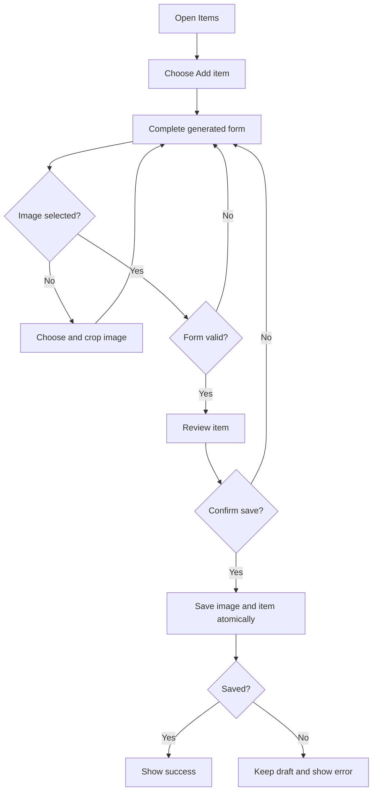
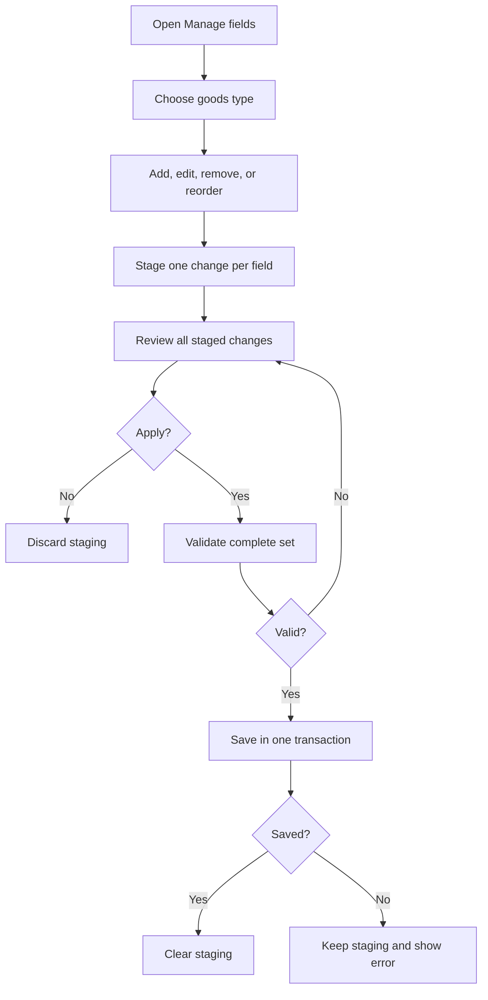
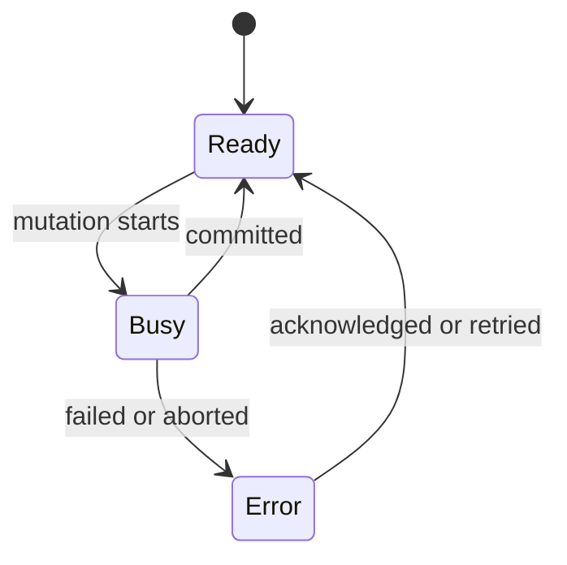

# Workflows

This document covers user workflows available in the current app. Record rules
come from [Domain Model](data-model.md). Transaction rules come from
[Persistence](persistence.md).

## Preferences

### Change Language

1. Open **Options** and expand **Language**.
2. Choose English, Japanese, or Traditional Chinese.
3. The app saves the locale and refreshes interface copy.
4. The next page load applies the locale before first paint.

Language affects interface text only. User-entered names, labels, and values stay
unchanged.

### Change Theme

1. Open **Options** and expand **Color theme**.
2. Turn dark mode on or off.
3. Choose an accent color from the color dots.
4. The app saves both choices and applies them at once.
5. The next page load applies them before first paint.

## My Collection

**My collection** shows active collection and item counts, plus deleted-item counts
within those collections. **Recent items** shows the five newest active items
by creation time. Select an entry to view its image, collection, and fields.
The detail window keeps a large image beside independently scrolling fields,
or above them on phones. Missing images have a labeled placeholder. This
read-only detail window is currently opened from Recent items.
Editing an older item does not move it to the top. Its three-dot menu lets you
move or hide the card. The plus tile can add it again.

### Create A Summary Card

1. Choose the plus tile and **Summary card**.
2. Name the card and use the visible choices for count, total, average, lowest,
   or highest value.
3. Select collections. For numeric calculations, choose one number field in each
   collection; field names may differ.
4. Optionally open the filter button beside each collection's name. Search and
   typed field rules use the item browser's conditions; date rules also offer
   **This year**. **Include deleted items** applies to all selected collections.
5. Choose no unit, yen (`¥`), dollars (`$`), NTD, or a custom unit. Only the custom
   choice has an editable text box. Choose its position and display preference.
6. Check the live preview, then save. Cancel discards the draft.

Filters match every rule; selected choices within a rule are alternatives.
Cards use active items unless **Include deleted items** is enabled. Missing
numeric values are excluded, while zero counts as a value. An average combines
individual values across collections. An empty numeric result shows `—`.

Counts and sums can show a ring broken down by collection or a selection or
two-option field. Category fields are chosen separately for each collection.
Uncategorized values form their own segment. Automatic display uses a plain
number when only one category contributes; Number only and Ring override it.
Negative category totals use a numerical breakdown instead of misleading ring
proportions. Units affect display only and never convert values. A unit that
does not fit beside its number moves onto one line of its own, with an ellipsis
if needed. Hovering it reveals the full unit text.

Number-only cards are compact and use the readable accent color. Rings use
shades of that accent around a neutral number, with no background track behind
the segments. Cards pack independently into up to three compact columns on
larger screens and follow saved order in one column on narrow screens. Each
column change animates retained card positions and dimensions from their visible
bounds, with a slight settling tilt, without scaling text or charts. Addition
and removal also animate. The page title keeps a fixed size; its decorative image wraps above it
when space is tight. These transitions respect reduced-motion preferences. Each
600 ms count and ring reveal starts when visible and respects reduced-motion
preferences. Counters start quickly and slow toward the final value, keeping
the final number's decimal precision throughout the animation. The centered
ring shows the total, with the largest segment selected with the same thick
band as a clicked pin, and its name and value (percentage) below. This selection
stays steady while hovering or focusing another segment to preview it temporarily.
Its reshaped edges leave matching clearance to both neighbors. Very small
segments use a smaller matched lift and gap to keep the shape visible.
Click or tap to pin that segment. Its band becomes slightly thicker while
keeping the hover gap and outer edge. The pin and its details stay steady until
another segment is pinned; Escape restores the largest default. Clicking the same segment keeps
its pin. Hover and keyboard previews still work with a pin set: another segment
lifts gently and shows a separate tooltip beside the pointer. Pointer targeting includes space
around the inner and outer edges of the band. Crossing into a neighboring
segment updates its preview immediately; a short leave delay applies only
outside the band.
Enter or Space pins the focused segment. Pins last while using
the current My collection page, including reordering cards, and reset after
leaving and returning to the largest default.
The full numerical breakdown remains in **Details**, including zero-value groups.
Long card titles use an ellipsis; their full names remain available on hover.

### Manage Cards

Use a card's three-dot menu for **Details**, editing, **Rearrange cards**, or removal. Details
contains source collections, filters, value coverage, and the exact breakdown.
Removing a summary card leaves its items intact.

**Rearrange cards** opens an edit mode with the same card layout and drag handles. Cards
shake slightly while editable. Drag with a mouse or touch; the page scrolls
near its top or bottom edge. Focus a handle and use arrow keys to reorder with
the keyboard. **Save order** applies the draft; **Cancel** restores the previous
order without changing saved cards. A lightweight placeholder follows the
pointer while dragging. The layout shown before saving matches the saved view.
Escape cancels an active drag first, then
leaves edit mode. Reduced-motion preferences disable shaking and movement.

Renaming a collection, field, or choice preserves its card references. An
unavailable reference names what changed and asks for a replacement through
**Edit card**; the app does not show a partial total. Changes made in another
tab reject a stale save instead of overwriting the newer configuration.

Card definitions, Recent items visibility, and ordering are saved with the
catalog and included in local and Drive backups. Debug changes remain temporary
and separate from user data.

## Collections

### Create A Goods Type

1. Open **Administration**.
2. Choose **Add goods type**.
3. Enter a name and optional description.
4. Review the values and protected fields.
5. Confirm the change.
6. The app creates the goods type and built-in fields in one transaction.
7. Navigation refreshes and opens the new Items view.

Duplicate display names show a warning but remain allowed. IDs are generated by
the app.

User mode writes to IndexedDB. Debug mode writes only to memory.

### Open A Collection

Choosing a goods type opens its Items view. The collection stays highlighted
while Items or Overview is open.

Use the information action in the view toolbar to open Overview. Use the return
arrow in the same position to return to Items.

Overview shows the collection metadata. It is not a separate navigation item.

## Browse Items

### Choose A Presentation

Cards are the default. List is the compact alternative.

Changing presentation keeps loaded items, filters, and sort state. Only the item
renderer changes.

Both views show the complete processed image. A square media region contains
portrait and landscape images without clipping.

Cards show at most three custom fields. They choose fields in this order:

1. applied filter fields
2. positive general-search matches
3. active custom sort field
4. schema order

When more matching fields exist, a disclosure shows their values without
changing card size.

### Filter Items

1. Open **Filter** from the view toolbar.
2. Enter general search text or add one rule per field.
3. Choose **Apply filters**.
4. The toolbar action shows the active rule count.

Rules stay staged until they are applied. Different field rules use AND logic.
Selected values inside one choice field use OR logic.

General search supports:

| Syntax | Meaning |
| --- | --- |
| `word` | case-insensitive term |
| `"full phrase"` | exact phrase |
| `-word` | excluded term |
| `-"full phrase"` | excluded phrase |

Field controls follow the field type:

| Type | Control |
| --- | --- |
| Text and long text | text comparison |
| Number | observed-value range slider |
| Date | open-ended date range |
| Two-option | direct multi-choice control |
| Selection list | direct multi-choice control |
| URL | text or domain match |

Internal item IDs and images are not filters.

Number sliders distribute distinct stored values by rank. One extreme value does
not compress the useful range.

Text, number, date, and URL rules may include missing values. For two-option and
selection rules, no selected choice means missing values only.

Applying a filter keeps entries keyed by item ID. Cards leave, retained cards
move, and new cards enter in separate short phases. Lists use the same prepared
item set.

### Sort Items

1. Open **Sort**.
2. Choose item metadata, name, or a supported custom field.
3. Choose ascending or descending order.
4. Apply the staged choice.

Recently updated is the default. Missing custom values stay last in both
directions.

Text uses case-insensitive natural order. Numbers and dates use their native
order. Two-option and selection fields use their visible labels.

## Change Items

### Add An Item

The draft stays in memory until save. Closing the dialog preserves unfinished
input. **Clear all** needs a second click before it discards the draft.

After a successful save, closing the success screen clears the draft. **Add
another** starts a fresh form.

#### Image Crop

The full source image is contained inside a fixed-height stage. The user drags
the crop box, changes its size with one slider, and chooses portrait or
landscape.

| Crop | Ratio | Output |
| --- | --- | --- |
| Portrait | `1:sqrt(2)` | `560 x 792` JPEG |
| Landscape | `sqrt(2):1` | `792 x 560` JPEG |

Crop controls do not resize or move the stage.

#### Value Rules

- Required fields use a neutral asterisk.
- Invalid input uses a warning marker.
- Scheme-less URLs become HTTPS.
- Explicit HTTP URLs are rejected.
- Dates use years `0001` through `9999`.
- Two-option fields always store one boolean.

An older item may miss a required value added after that item. The browser marks
the item as incomplete until it is edited.

The app validates the full draft before review. A failed save keeps the draft
and shows a storage-specific error.

### Edit An Item

1. Choose the edit icon.
2. Change values in the generated form.
3. Keep the current image or replace and crop it.
4. Review and apply the change.

Closing preserves the draft. **Clear changes** restores the values loaded when
editing began.

Changing text or custom values does not rewrite the image. Replacing an image
writes the new image and item and removes the old image in one transaction.

After save, the item is filtered and sorted again. Its keyed entry moves or
leaves without rebuilding the full presentation.

### Delete An Item

1. Choose the delete icon.
2. Confirm the recoverable deletion.
3. The app writes a lifecycle-only change.
4. The item leaves active browsing after the write succeeds.

The item values and image remain stored. Cancelling or a failed write leaves the
item visible.

### Recover Deleted Items

Open **Deleted items** from the view toolbar. The dialog contains only
deleted items from that collection.

Restore keeps the same ID, values, image, and creation time. The item returns to
the active browser using its current filters and sort order.

Permanent purge has a separate destructive confirmation. It removes the deleted
item and its retained image in one transaction.

## Administration

### Back Up Local Data

1. Open **Administration**.
2. Choose **Export backup**.
3. The app validates one complete catalog and downloads a `.json.gz` archive.

The file includes active and soft-deleted goods types, fields, items, all
retained images, and saved cards with their ordering. Export is
read-only. Theme, accent, language, and cached app files are not included.

### Restore Local Data

1. Open **Administration** and choose **Restore from file**.
2. Select an Oshimochi `.json.gz` backup.
3. Review its date, record counts (including saved cards), and total image size.
4. Confirm the replacement.

The app parses and validates the complete file before a write starts. Confirmed
restore replaces every local collection, field, item, image, and saved card
in one transaction. It does not merge data. Released version-1 backups restore
with an empty card list.

An invalid file leaves local data unchanged. A failed replacement also keeps the
previous catalog. After a successful commit, navigation reloads from the restored
goods types.

### Configure Personal Drive Backup

Follow the [Google Drive setup guide](google-drive-backup.md) to create public
Google configuration and save it in **Administration**. Setup values stay on
the current browser origin and are not included in backups.

### Back Up To Google Drive

1. Open **Administration**.
2. Choose **Connect** and approve Drive access.
3. Choose the **Backup folder** row and select an existing folder.
4. Choose **Back up now**.
5. Wait for upload confirmation.

The app uploads the same gzip archive used by local export. Files go to the
selected folder. The newest three Oshimochi snapshots in that folder are
retained.

### Restore From Google Drive

1. Open **Administration** and connect if needed.
2. Choose **Restore from cloud**.
3. Choose one listed backup.
4. Review its record counts and image size.
5. Confirm full replacement.

Download and validation finish before any local write. The replacement uses
the same atomic restore operation as a local file.

### Manage Fields

Use **Manage fields** in user-facing copy. The UI does not expose database terms
such as columns or object stores.

Staged changes exist only in memory. Leaving the workflow discards them.

Protected rules:

- built-in fields cannot be removed
- `id` and `name` cannot become optional
- two-option fields are always required
- internal keys and IDs are not editable

Supported edits:

- rename a field
- reorder fields
- change required to optional
- rename a selection choice
- add a selection choice
- soft-delete a custom field

Soft-deleting a field keeps existing item values.

### Reset Local Data

1. Open **Administration** and choose **Reset local data**.
2. Read the list of browser-local data that will be removed.
3. Type `RESET`.
4. Confirm the operation.

The app clears goods types, fields, items, images, and saved cards in one
transaction. It keeps theme and language settings and cached app files.

## Shared Mutation State

While busy, the app blocks conflicting writes and keeps progress visible. Reads
and navigation remain available when they cannot damage the active workflow.
