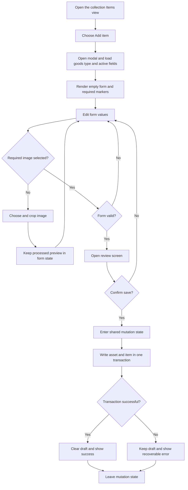
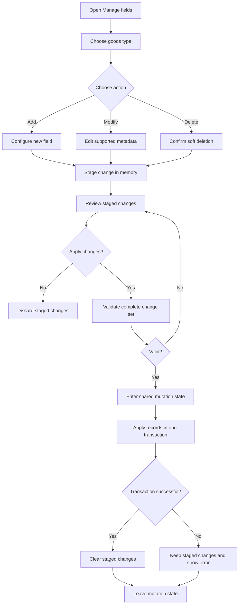
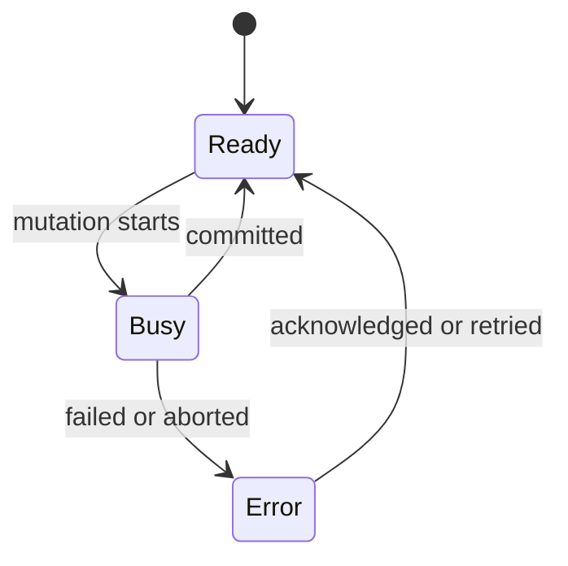

# Workflows

This document specifies implemented and planned user workflows. Their data rules
come from [Domain Model](data-model.md), and their transactions follow
[Persistence](persistence.md).

## Change Interface Language

Status: implemented.

1. User opens **Options** and expands **Language**.
2. User chooses English, Japanese, or Traditional Chinese.
3. The selected locale is written to browser `localStorage` and the application
   remounts the current Options view with translated shell and workflow copy.
4. On later visits, a synchronous bootstrap applies the root document language
   before CSS and normal startup run.

Language is an interface preference only. User-entered collection names, field
names, option labels, and item values remain exactly as entered. The app uses an
offline-safe locale-aware Noto Sans stack with platform CJK fallbacks throughout
the interface; it does not request fonts from a third-party host.

## Create Goods Type

Status: implemented.

1. User opens Administration.
2. User chooses **Add goods type**.
3. User enters a display name and optional description.
4. The form validates required text and duplicate naming guidance.
5. A review step shows the entered type details and explains that protected fields
   are created automatically.
6. Confirmation creates the goods type and built-in field definitions atomically.
7. Navigation refreshes and opens the new goods type's Items view.

Display names do not need to be globally unique, but the UI should warn when an
active type already uses the same normalized name. IDs are generated internally.
User mode persists the result in IndexedDB. Debug mode applies the same workflow
to temporary in-memory data that disappears when the page reloads.

## Open A Collection

Status: implemented.

1. User chooses a goods type in primary navigation.
2. The app opens that collection's Items view immediately.
3. The collection remains highlighted while the user browses Items or its
   secondary Overview route.
4. User may open **Collection overview** from the title-bar information action.
5. User returns to Items through the title-bar return arrow or by
   choosing the collection in primary navigation again.

The information action is the rightmost Items control. The Overview return arrow
uses the same top-right anchor, so opening metadata does not move the control the
user must use to leave it.

Overview is intentionally outside primary navigation. It holds collection
metadata and remains available for future collection-level summaries without
adding another permanent destination to the navigation pane.

## Add Item

Status: generated fields, image cropping, review, atomic persistence, and listing
are implemented.

The draft and cropped image stay in UI memory until confirmation. The complete
source image is proportionally contained inside a fixed-height preview stage.
The preview image and crop bounds share the same explicit rendered rectangle,
so the complete source remains visible without horizontal scrolling. The user moves a crop rectangle
directly, changes its size with one slider, and switches its ratio with a
two-state portrait/landscape control. Those controls do not resize the stage.
Allowed crop ratios are portrait `1:sqrt(2)` and horizontal `sqrt(2):1`; the
generated JPEGs use fixed `560 x 792` or `792 x 560` output dimensions regardless
of source size or selected crop size.

Required entry fields use a neutral asterisk. Red warning indicators are
reserved for invalid input and persisted items that are missing required values.

Scheme-less web addresses are normalized to HTTPS and explicit HTTP addresses are
rejected. Two-option toggle fields have user-defined labels and always store
`true` or `false` for newly registered items. An unset value only exists when an
older item predates a newly added required field; the item list marks that
record as incomplete.

The editor applies the same domain validation used by persistence before opening
the review screen. Dates use four-digit years from `0001` through `9999`. Known
save failures show their actionable cause; browser-storage quota failures are
reported explicitly.

Closing the Add item dialog preserves an unfinished draft. **Clear all** uses a
two-click confirmation before discarding it. Closing the post-save success
screen is different: reopening Add item starts with a fresh draft rather than
returning to the previous Add another/Done screen.

Two-option fields are always required. Administration does not expose an
Optional setting for them. Legacy optional two-option definitions may be
upgraded to required without rewriting items; records that lack a value remain
visible with the same incomplete-item warning.

## Filter Items

Status: implemented for list and card presentations.

1. User opens **Filter** from the collection title bar.
2. User may enter a general search and add at most one rule for each active field.
3. Changes remain staged inside the dialog until **Apply filters** is chosen.
4. The item browser evaluates all applied field rules with AND semantics and
   shows the number of active filters in the title-bar action.
5. Clearing and applying filters restores the complete collection without
   reloading storage. The empty-result view also offers an immediate clear action.

Applying or clearing filters reconciles visible entries by item ID. List rows
collapse or expand, while cards scale out or in and the remaining grid reflows.
The complete presentation is not torn down and rebuilt.

Card membership changes run in three short phases: outgoing cards disappear
while the grid remains fixed, retained cards move into the final grid, and new
cards appear only after movement finishes. Empty phases are skipped.

Outgoing cards remain in grid flow until their exit phase finishes. Incoming
cards occupy their final grid positions invisibly during movement, preventing
membership changes from competing visually with retained-card reordering.

Newly saved items use the same keyed reconciliation path. A matching item grows
into its collection position without replacing or reloading the existing list.

General search is case-insensitive. Space-separated terms use AND semantics,
quoted text matches a complete phrase, and a leading `-` excludes a term or
quoted phrase. Internal item UUIDs are neither searchable nor exposed as field
filters. Field rules follow their data type: text comparisons, collection-scaled
number sliders, open-ended date ranges, direct multi-choice controls for
two-option and selection-list fields, and URL text or domain matching. Equal
date endpoints mean one exact date. An empty first or second endpoint means no
lower or upper bound respectively.

Numeric sliders distribute distinct observed values evenly by rank rather than
by arithmetic distance. Extreme outliers therefore receive one position without
compressing the ordinary values into an unusable section of the track; selected
positions still resolve to their real inclusive numeric bounds.

Text, number, date, and URL rules can also include records that have no value for
that field. Two-option and selection-list rules need no separate missing-value
control: selecting no choices means missing values only, and selected choices
combine with OR. Image is required and is not exposed as a filter. Different
field rules combine with AND.

Filtering is an in-memory application operation over records already loaded by
the item browser. It is independent from list and card markup, so both consume
the same result set.

## Sort Items

Status: implemented for list and card presentations.

1. User opens **Sort** from the collection title bar.
2. User chooses last update, creation date, item name, or a supported custom field.
3. User chooses ascending or descending order and applies the staged selection.
4. Existing rows move into their new positions without being recreated.

Recently updated is the default order. Missing custom values always remain at
the end in either direction. Text uses case-insensitive natural ordering, while
numbers and dates retain their native order. Two-option and selection-list
fields sort by the labels visible to the user rather than their stored values.

Sorting runs after records are loaded and before filtering is evaluated. Both
presentations consume the same ordered result set.

## Switch Item Presentation

Status: implemented.

Cards are the default whenever a collection Items view is opened. List remains
available as a compact alternate presentation.

1. User chooses the list or card icon in the collection title bar.
2. The item browser retains loaded records and all applied filter and sort state.
3. Only the presentation renderer changes with a short content transition.

Cards prioritize the complete processed image and item name. Their square image
stage contains either supported
90-degree crop orientation without clipping, so portrait and landscape assets use
the same card geometry. The thumbnail renderer uses stored asset dimensions rather
than relying on image-load timing, and centers the complete processed image over a
subtle media surface.

Cards show up to three custom fields. Field priority is applied filter rules,
positive general-search matches, the active custom sort field, then schema order.
If more filtered fields match than the card can show, a disclosure opens their
values without changing card geometry. Both presentations expose edit and delete
actions and use keyed updates after item mutations.

## Edit Items

Status: implemented for list and card presentations.

1. User opens an item through its edit icon.
2. The existing generated form is populated from the item and current field definitions.
3. The current image remains selected unless the user explicitly replaces and crops it.
4. User reviews the complete item and applies the changes.
5. The active presentation updates the keyed entry and reevaluates its filter and sort position.

Closing the editor preserves the active draft. **Clear changes** uses a two-click
confirmation and restores the values loaded when editing began. After a successful
save, closing the success screen clears that draft.

Text and custom values update without rewriting the image asset. Replacing the
image writes the new asset and item and removes the superseded asset in one
transaction. A failed transaction retains the review and draft for another attempt.

## Delete Items

Status: implemented for active items in list and card presentations.

1. User chooses the delete icon on an item row.
2. A modal confirmation identifies the item and explains that deletion is recoverable.
3. Confirming enters the shared mutation state and writes deletion timestamps.
4. The item record, custom values, and image asset remain in local storage.
5. After the write succeeds, only the deleted keyed entry leaves the active presentation.

Closing or cancelling the confirmation does not change the item. A failed write
keeps the item visible and presents the actionable storage error for another
attempt. Active filters and sorting are retained while the row is removed.

Restoration and permanent purge controls are separate future work. Until those
controls exist, soft-deleted records are retained but intentionally omitted from
the active collection UI.

## Recover Deleted Items

Status: planned next.

1. User opens a dedicated deleted-items view for one collection.
2. The view reads the `deleted` item scope and shows the deletion state without
   mixing those records into active browsing.
3. User selects an item and chooses **Restore**.
4. Confirmation enters the shared mutation state and applies a lifecycle-only
   transition.
5. The restored item returns to active browsing with the same values, image, ID,
   and creation timestamp.

Permanent purge is a separate command within the recovery area. It requires
explicit destructive confirmation and removes the item plus its retained image
asset in one transaction. Restoration and purge must not reuse the ordinary item
editor because that editor owns content changes rather than lifecycle changes.

## Manage Fields

Status: implemented.

Use **Manage fields** in visible UI. Do not expose terms such as column, object
store, or schema migration to ordinary users.

Rules:

- staged changes exist only in memory
- one staged change is allowed per field
- built-in fields cannot be deleted
- `id` and `name` cannot become optional
- deleting a field preserves existing item values
- the complete staged set is validated before opening a transaction

The current UI supports text, long text, number, date, two-option toggle, web-address, and
selection-list fields. Internal keys are generated once and are not exposed to
ordinary users. Selection options receive stable IDs. Existing options may be
renamed or extended, but not removed. Renaming changes only the display label;
stored item values continue to reference the same option ID.

Safe initial modifications:

- rename a display label
- rename a selection-option label without changing its stable ID
- change required to optional
- change field position
- add select options without invalidating existing values

Deferred migrations:

- change field data type
- make a field required while existing values are empty
- change a stable field key
- remove select options used by existing items

## Reset Local Data

Status: implemented.

1. User opens Administration and chooses **Reset local data**.
2. The confirmation view explains which browser-local records will be removed.
3. User types `RESET` exactly.
4. Confirmation enters the shared mutation state and clears goods types, field
   definitions, items, and image assets in one transaction.
5. Navigation remounts in the clean empty state.

The operation does not remove theme settings, cached application files, or any
backup previously exported outside the application.

## Export Backup

Status: planned after deleted-item recovery.

1. User starts an export from the data-management area.
2. The application reads complete `all` scopes, including soft-deleted records
   and retained assets.
3. It validates and maps those records into one versioned snapshot.
4. The browser downloads the snapshot as a local file.

Export is read-only and does not enter the global mutation state. A failed export
must leave local data untouched and report its actionable cause.

## Import Backup

Status: planned after deleted-item recovery.

1. User chooses a supported backup file.
2. The application parses and validates the complete snapshot without changing
   local data.
3. A review identifies the snapshot, record counts, creation time, versions, and
   the replacement effect.
4. The user explicitly confirms replacing the current local collection.
5. The application enters the shared mutation state and replaces all user-data
   stores atomically.
6. Navigation and the active view remount only after commit succeeds.

The first import strategy is replacement, not merge. Invalid or unsupported
files never open a write transaction. Before replacement, the interface offers
an export of the current collection rather than creating a hidden database copy.

## Mutation State

When busy, the application disables conflicting mutations and keeps progress
visible. Harmless reading and navigation remain available when the active flow
can survive navigation safely.
